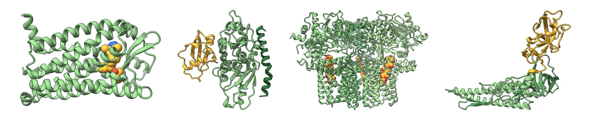

**Biotechnologist (MSc, BOKU Vienna)** working where the bench meets the computer: I clone,
transform, grow and image plants, and I use structural bioinformatics to decide what is worth
testing. Before research I worked in food-safety quality control.

📍 Vienna · available from **January 2027** · [portfolio](https://alvar56.github.io) ·
[LinkedIn](https://www.linkedin.com/in/alvar-pascual-garc%C3%ADa-194538242)

---

#### What's here

| | Project | What it shows |
| --- | --- | --- |
| 🧬 | **[bioinformatics-analyses](https://github.com/Alvar56/bioinformatics-analyses)** | Reproducible Python analyses on PDB, AlphaFold and UniProt data: AlphaFold vs crystal structure for CCR5, which structures can stand in for Arabidopsis CESA6, AlphaFold confidence across the ATG8 conjugation machinery, and ISO 7218 / MPN calculations for food microbiology. Tested with pytest and CI. |
| 🎨 | **[structure-renders](https://github.com/Alvar56/structure-renders)** | A ChimeraX + Python pipeline that turns PDB entries into a consistent series of publication-style figures: one recipe per protein, one house style. |
| 🎬 | **[tonoplast-scenes](https://github.com/Alvar56/tonoplast-scenes)** | Python-scripted Blender + Molecular Nodes scenes of the plant vacuole membrane: the V-ATPase in a lipid bilayer with ATG12–ATG5–ATG16 complexes, as a seamless loop. |
| 🦊 | **[german-trainer](https://github.com/Alvar56/german-trainer)** | *Deutsch mit Felix*, the React app I built to learn German: generated grammar exercises, spaced repetition, vocabulary import and an offline Android build. |
| 🌱 | **[alvar56.github.io](https://github.com/Alvar56/Alvar56.github.io)** | My portfolio: a static site whose hero is a canvas garden of *Arabidopsis* and *N. benthamiana* that reacts to the cursor. |

#### Toolbox

**Wet lab** · GreenGate cloning · *E. coli* and *Agrobacterium* transformation · floral dip ·
confocal microscopy (Huygens, FIJI) · root-growth assays · *Salmonella* / *Listeria* detection ·
TEMPO counts · sterile technique

**Computational** · Python (NumPy, Biopython, Matplotlib, pytest) · AlphaFold · AutoDock Vina ·
ChimeraX · FATCAT · SWISS-MODEL · Blender + Molecular Nodes · JavaScript / React

**Languages** · Spanish (native) · English (professional) · German (learning)
